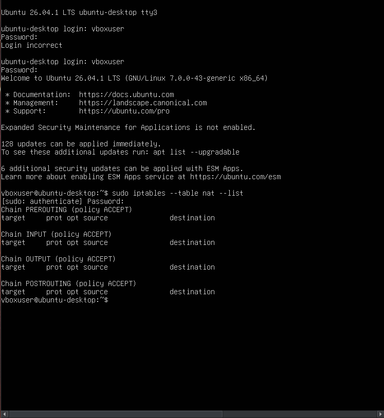
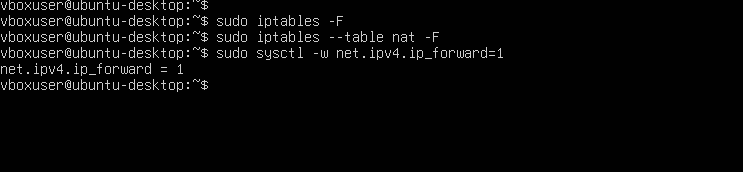
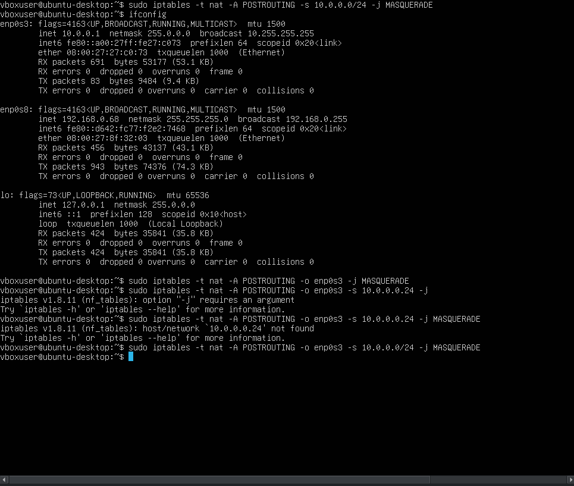
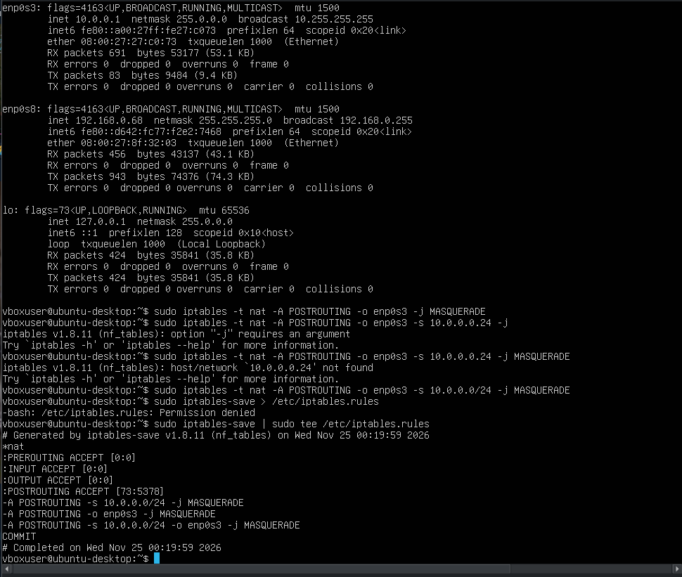
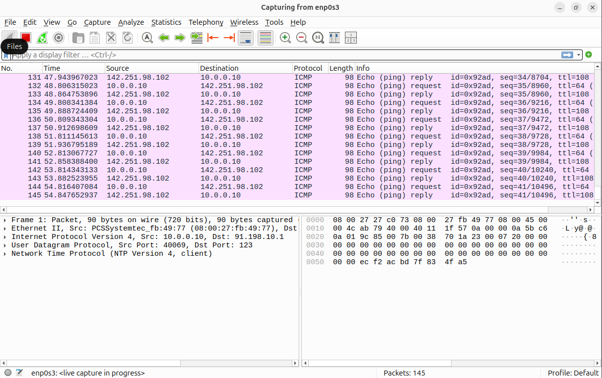
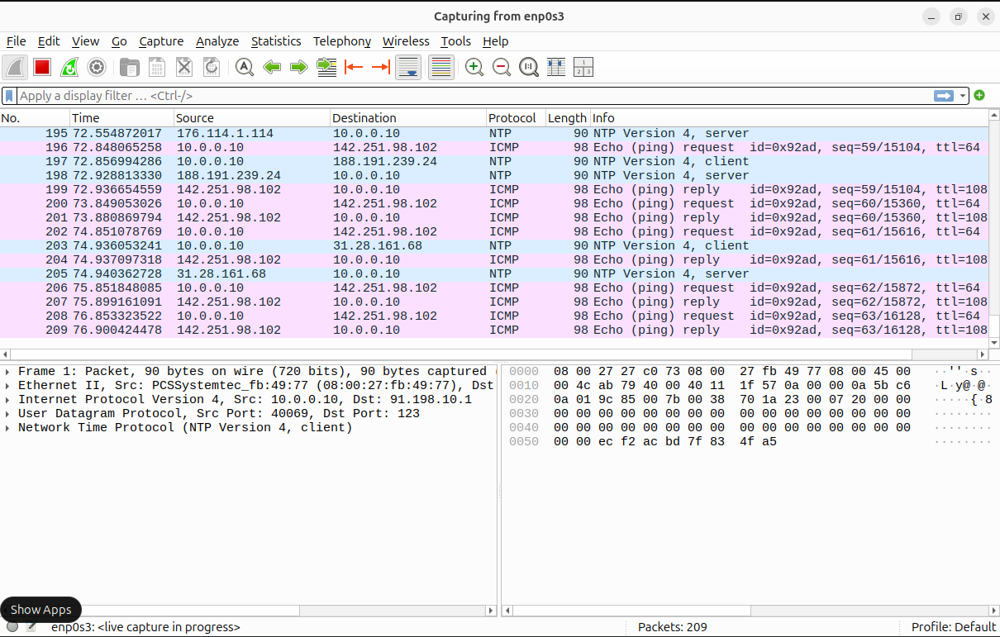

# Test cases

**Test 1.1** NAT table baseline, IPv4 forwarding

**Test objective:** Verify that the NAT table starts with no rules and that IPv4 forwarding can be turned on, so the host can forward packets as a gateway.

**Preconditions:** Ubuntu 26.04.1 LTS virtual machine, user vboxuser, host name ubuntu-desktop, kernel 7.0.0-43-generic. iptables 1.8.11 (nf_tables) is installed. The tester can run iptables and sysctl with administrator rights.

**Requirements:** FU-1. Before any NAT rule is added, the nat table contains no rules. The gateway must be able to forward IPv4 packets.

**Priority:** High

**Severity:** Major

**Tester:** Vladyslav Sukhomlin

**Result:** Passed.

**Attachments:** nat-table-empty.png; ip-forward-enable.png.

| Steps | Expected result |
| --- | --- |
| List the nat table. | Chains PREROUTING, INPUT, OUTPUT and POSTROUTING are present. Each policy is ACCEPT. No rules are listed. |
| Flush the filter table and the nat table. | Both commands finish with no error. The nat table stays empty. |
| Enable IPv4 forwarding. | sysctl prints net.ipv4.ip_forward = 1. |

## Attachments

Run evidence, 25 Nov 2026.

### nat-table-empty.png

Ubuntu 26.04.1 LTS, host ubuntu-desktop, user vboxuser. The first login attempt is rejected. After login, `sudo iptables --table nat --list` shows chains PREROUTING, INPUT, OUTPUT and POSTROUTING. Each policy is ACCEPT, and none of the chains has a rule.

### ip-forward-enable.png

`sudo iptables -F` and `sudo iptables --table nat -F` finish with no output. `sudo sysctl -w net.ipv4.ip_forward=1` prints `net.ipv4.ip_forward = 1`.

**Test 1.2** MASQUERADE for subnet 10.0.0.0/24, saved rules

**Test objective:** Verify that a POSTROUTING MASQUERADE rule for 10.0.0.0/24 is accepted, that a malformed rule is rejected with a readable error, and that the ruleset can be saved.

**Preconditions:** IPv4 forwarding is on (Test 1.1). Inside interface enp0s3 is up at 10.0.0.1/8, MAC 08:00:27:27:c0:73. Outside interface enp0s8 is up at 192.168.0.68/24, MAC 08:00:27:8f:32:03. The rules file is `/etc/iptables.rules`. The tester can write that file as root.

**Requirements:** FU-2. Traffic from 10.0.0.0/24 must match a POSTROUTING MASQUERADE rule. A rule with a missing target, or a source that is not an address, must be rejected. The ruleset must be stored in `/etc/iptables.rules`.

**Priority:** High

**Severity:** Major

**Tester:** Vladyslav Sukhomlin

**Result:** Passed.

**Attachments:** masquerade-and-interfaces.png; iptables-rules-save.png.

| Steps | Expected result |
| --- | --- |
| Check the inside and outside interfaces. | enp0s3 is up at 10.0.0.1/8. enp0s8 is up at 192.168.0.68/24. |
| Add a POSTROUTING MASQUERADE rule for source 10.0.0.0/24. | iptables accepts the rule. |
| Submit a rule whose -j has no target, then a rule whose source is 10.0.0.0.24. | The first line is rejected: option "-j" requires an argument. The second line is rejected: host/network `10.0.0.0.24' not found. Neither line adds a rule. |
| Save the ruleset to /etc/iptables.rules. | The file contains a POSTROUTING MASQUERADE rule for source 10.0.0.0/24. A redirect opened by the unprivileged shell is refused. A write as root succeeds. |

## What the messages mean

iptables v1.8.11 (nf_tables) rejects a command before it inserts a rule when the command is incomplete or the address does not parse.

`option "-j" requires an argument` means the jump target was left off. The line that ends with `-j`, with no MASQUERADE after it, stops there. `host/network '10.0.0.0.24' not found` means the source token is not an IP prefix: the slash in 10.0.0.0/24 was typed as a fourth dot, and iptables tried to resolve that token as a host name.

`Permission denied` on `sudo iptables-save > /etc/iptables.rules` comes from the shell. The redirect opens `/etc/iptables.rules` as vboxuser, before sudo starts. `sudo iptables-save | sudo tee /etc/iptables.rules` opens the file as root. The saved file is dated Wed Nov 25 00:19:59 2026. POSTROUTING had already passed 73 packets (5378 bytes).

The saved source rule, `-s 10.0.0.0/24 -j MASQUERADE`, matches traffic from that subnet on whichever interface the packet leaves. MASQUERADE then uses the address of that interface. On this gateway the outside address is 192.168.0.68 on enp0s8.

Two other saved rules set `-o enp0s3`. enp0s3 holds 10.0.0.1 and is the inside interface, so those rules describe traffic leaving back into the inside network. iptables accepts them. The path from host 10.0.0.10 toward the Internet matches the source rule. enp0s3 is configured as 10.0.0.1/8, while the NAT rule covers 10.0.0.0/24. Host 10.0.0.10 belongs to both prefixes, so this client matches the rule.

## Attachments

Run evidence, 25 Nov 2026, 00:19.

### masquerade-and-interfaces.png

`sudo iptables -t nat -A POSTROUTING -s 10.0.0.0/24 -j MASQUERADE` is accepted. ifconfig then shows enp0s3 up at 10.0.0.1/8, MAC 08:00:27:27:c0:73, and enp0s8 up at 192.168.0.68/24, MAC 08:00:27:8f:32:03. The following line, `-o enp0s3 -j MASQUERADE`, is accepted. The line that ends in `-j` with no target is rejected: option "-j" requires an argument. The line with source 10.0.0.0.24 is rejected: host/network `10.0.0.0.24' not found. The line `-o enp0s3 -s 10.0.0.0/24 -j MASQUERADE` is accepted.

### iptables-rules-save.png

`sudo iptables-save > /etc/iptables.rules` prints `-bash: /etc/iptables.rules: Permission denied`. `sudo iptables-save | sudo tee /etc/iptables.rules` writes the ruleset, generated by iptables-save v1.8.11 on Wed Nov 25 00:19:59 2026. POSTROUTING ACCEPT [73:5378]. Three MASQUERADE rules are stored: source 10.0.0.0/24; output interface enp0s3; source 10.0.0.0/24 together with output interface enp0s3.

**Test 1.3** ICMP and NTP from the internal host, inside capture

**Test objective:** Verify that internal host 10.0.0.10 reaches public addresses and that the replies are delivered back to that private address.

**Preconditions:** IPv4 forwarding is on and the MASQUERADE rule for 10.0.0.0/24 is loaded (Tests 1.1 and 1.2). Wireshark on the gateway can capture enp0s3. Internal host 10.0.0.10, MAC 08:00:27:fb:49:77, uses this gateway.

**Requirements:** FU-3. An internal host must exchange ICMP and NTP with public addresses. On the inside interface, the return packets must be addressed to the private host.

**Priority:** High

**Severity:** Critical

**Tester:** Vladyslav Sukhomlin

**Result:** Passed.

**Attachments:** icmp-capture-enp0s3.png; ntp-capture-enp0s3.png.

| Steps | Expected result |
| --- | --- |
| Start a capture on the inside interface. | Wireshark is capturing from enp0s3. |
| Review ICMP between the internal host and a public address. | Echo requests go from 10.0.0.10 to 142.251.98.102. Echo replies come from 142.251.98.102 to 10.0.0.10. |
| Review NTP on the same capture. | The internal host sends NTP client packets to public servers. NTP server packets return to 10.0.0.10. |

## Attachments

Run evidence, 25 Nov 2026. The capture is on the inside interface, so the private address stays visible. Translation is applied when the packet leaves the outside interface. A working return path shows the reply addressed to 10.0.0.10.

### icmp-capture-enp0s3.png

Wireshark is capturing from enp0s3. The visible rows are ICMP echo requests from 10.0.0.10 to 142.251.98.102 (ttl 64, id 0x92ad) and echo replies from 142.251.98.102 to 10.0.0.10 (ttl 108). The detail pane is on frame 1, an NTP version 4 client packet from 10.0.0.10 to 91.198.10.1, UDP 40069 to 123. The Ethernet source of that frame is 08:00:27:fb:49:77.

### ntp-capture-enp0s3.png

The same capture, later in the list (209 packets). NTP server 176.114.1.114 replies to 10.0.0.10. Host 10.0.0.10 sends NTP client packets to 188.191.239.24 and to 31.28.161.68, and both servers reply to 10.0.0.10. ICMP echo requests and replies with 142.251.98.102 continue through the same rows (seq 59–63).
